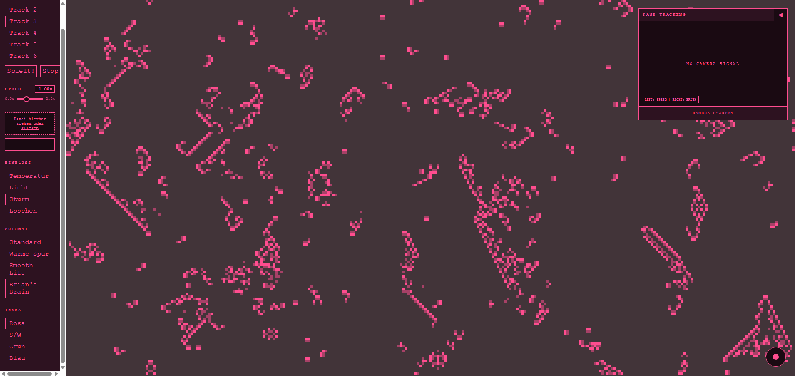
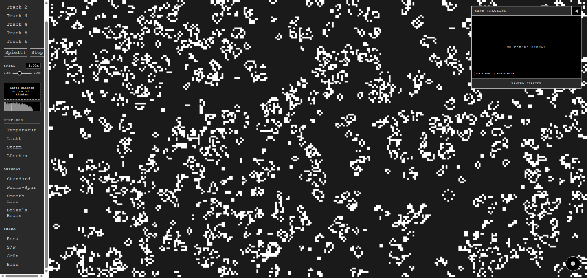
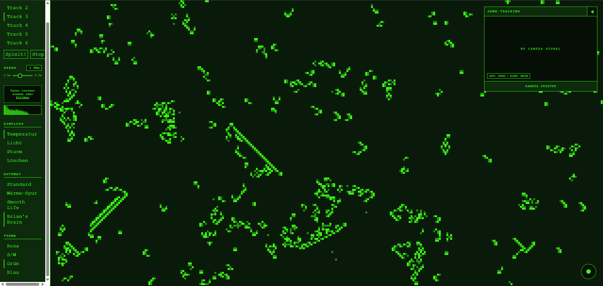
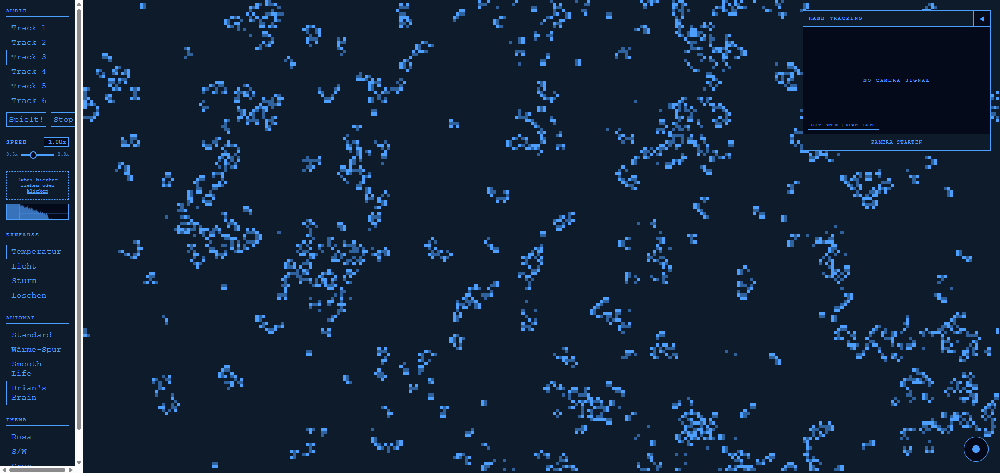
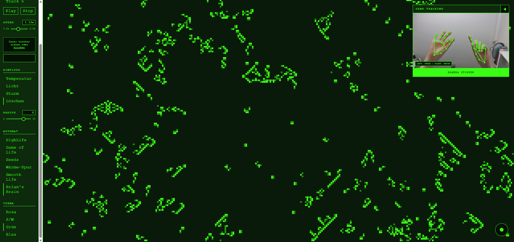
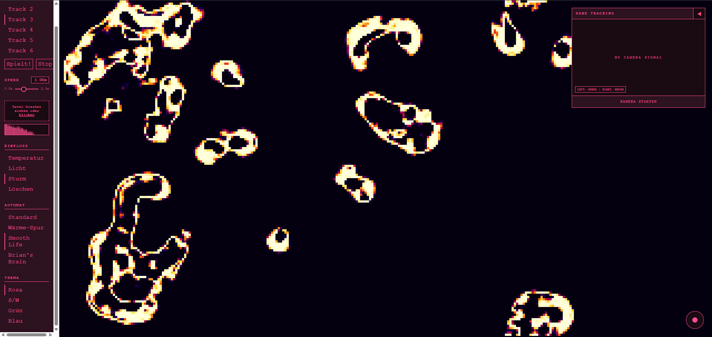
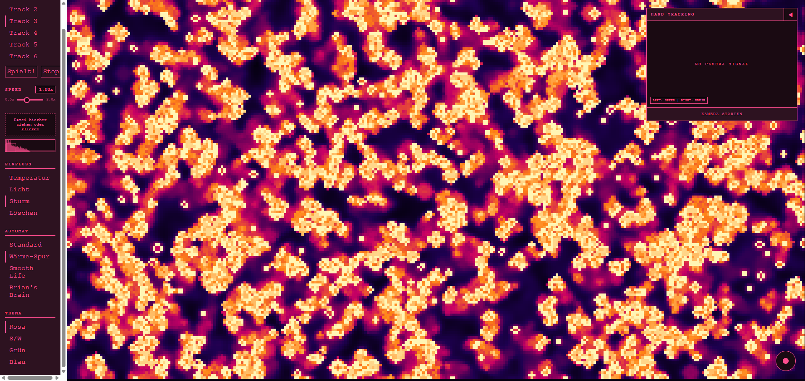

# Zelluläre Automaten

Webbasiertes DJ/VJ-Tool mit verschiedenen zellulären Automaten, die dynamisch auf Musik reagieren sowie durch die Maus oder Handgesten manipuliert werden können.

Projekt im Rahmen des Moduls **Emerging Technologies** an der HTW Berlin.



---

## Inhalt

- [Über das Projekt](#über-das-projekt)
- [Features](#features)
- [Quickstart](#quickstart)
- [Bedienung](#bedienung)
- [Architektur](#architektur)
- [Technische Details](#technische-details)
- [Git-Workflow](#git-workflow)
- [Einschränkungen & Ausblick](#einschränkungen--ausblick)
- [Audio-Quellen & Lizenz](#audio-quellen--lizenz)
- [Autoren](#autoren)

---

## Über das Projekt

Zelluläre Automaten wie Conways *Game of Life* erzeugen aus wenigen lokalen Regeln
komplexe globale Muster und erzeugen so den Anschein von "Leben". Normalerweise wird die Erscheinung entsprechend der Regeln konstant aktualisiert. Unser Projekt bringt hier etwas Dynamik mit rein.

Die Idee war es, diesen geschlossenen Kreislauf aufzubrechen und das Wachstum des Automaten ebenso von Musik abhängig zu machen.
Der Benutzer hat darüber hinaus die Möglichkeit über bestimmte Einflüsse (siehe [Features](#features)) die Zellen des Automaten live anzupassen.

Darüber hinaus lässt sich die Geschwindigkeit der Musik sowie die farbliche Darstellung des User Interfaces anpassen.

Das Ergebnis ist eine Art audiovisuelles Instrument, dessen Ausgabe sich als Video
mitschneiden lässt.

Technisch ist das Projekt bewusst ohne Framework umgesetzt: Vanilla JavaScript,
ES-Module und die nativen Browser-APIs (Canvas 2D, Web Audio API, MediaRecorder,
getUserMedia). Die einzige nennenswerte Abhängigkeit ist MediaPipe für das Handtracking.

---

## Features

| Feature | Beschreibung |
|---|---|
| **5 Automaten** | HighLife, Game of Life, Seeds, Smooth Life, Brian's Brain |
| **Wärme-Spur** | Zuschaltbare Darstellung, die vergangene Zellzustände als abkühlende Spur zeigt – kombinierbar mit jeder Regel |
| **Audioreaktivität** | Signalenergie steuert die Simulationsgeschwindigkeit, Bassschläge erzeugen neue Zellen in unmittelbarer Umgebung bereits aktiver Zellen |
| **Audio-Visualizer** | FFT-Spektrum mit Markierung der drei Frequenzbänder |
| **Eigene Musik** | Sechs mitgelieferte Tracks plus Drag & Drop für eigene Audiodateien |
| **Handtracking** | Zwei Hände über die Webcam: rechts malt, links regelt per Pinch-Geste die Geschwindigkeit |
| **4 Pinselmodi** | Temperatur, Licht, Sturm und Löschen – per Maus, Tastatur oder Hand, mit einstellbarem Radius |
| **4 Farbthemen** | Rosa, S/W, Grün, Blau – wirken auf UI, Automat und Handtracking-Overlay |
| **Videoaufnahme** | Mitschnitt von Canvas und Audio als WebM-Datei |

---

## Quickstart

### Voraussetzungen

- **Node.js** ≥ 18 und npm
- Ein aktueller Browser mit Unterstützung für Web Audio API und `canvas.captureStream()`
  (getestet in Chrome, Firefox und Safari)
- Für das Handtracking: eine **Webcam** und eine Seite, die über `localhost` oder
  HTTPS ausgeliefert wird (Browser geben `getUserMedia` sonst nicht frei)

### Installation & Start

```bash
git clone https://gitlab.rz.htw-berlin.de/s0582256/zellulaere-automaten.git
cd zellulaere-automaten
npm install
npm run dev
```

Vite gibt eine lokale Adresse aus (in der Regel `http://localhost:5173`).
Da dies `localhost` ist, funktioniert der Kamerazugriff ohne HTTPS-Zertifikat.

### Weitere Skripte

```bash
npm run build     # Produktions-Build nach dist/
npm run preview   # Build lokal ausliefern
```

---

## Bedienung

### Sidebar

**AUDIO** – Einer der sechs Tracks wird per Klick geladen und startet sofort.
`Play` spielt alternativ den Standardtrack, `Stop` beendet die Wiedergabe.
Über die Drop-Zone lassen sich eigene Dateien per Drag & Drop oder Klick laden.
Alles, was nicht als `audio/*` erkannt wird, wird ignoriert.

**SPEED** – Der Slider (0.5x – 2.0x) verändert die **Abspielgeschwindigkeit der Musik**.
Da die Automatengeschwindigkeit indirekt aus der Energie der Musik abgeleitet wird, beschleunigt ein schnellerer Track entsprechend auch den Automaten.

**EINFLUSS** – Die vier Pinselmodi:

| Label im UI | interner Modus | Wirkung |
|---|---|---|
| Temperatur | `spray` | setzt zufällig ca. 35 % der Zellen im Radius auf lebendig |
| Licht | `heat` | füllt den kompletten Radius mit lebenden Zellen |
| Sturm | `storm` | invertiert jede Zelle im Radius |
| Löschen | `erase` | löscht alle Zellen im Radius |

**RADIUS** – Der Slider (2 – 10 Zellen) bestimmt die Größe des Pinsels und gilt für
alle vier Modi gleichermaßen.

**AUTOMAT** – Wechselt zwischen den fünf Regelwerken. Beim Wechsel wird der
laufende Automat gestoppt und ein neuer mit frisch initialisiertem Gitter erzeugt. Farbthema, Pinselmodus und
Pinselradius werden auf die neue Instanz übertragen.

**WÄRME-SPUR** – Schaltet die Wärme-Darstellung an oder aus. Sie gilt für den aktuell
gewählten Automaten und bleibt beim Wechsel erhalten. Bei Smooth Life ist der Schalter
deaktiviert, weil dieser Automat bereits eine eigene Farbabbildung mitbringt.

**THEMA** – Setzt die Farbpalette. Die Farben werden als CSS-Custom-Properties
(`--accent`, `--bg`, `--surface`) gesetzt und zusätzlich an das Automaten-Objekt
übergeben, damit Canvas, Visualizer und Hand-Overlay dieselben Farben nutzen.

| **Rosa** | **S/W** |
|---|---|
|  |  |
| **Grün** | **Blau** |
|  |  |

### Maus
Klicken und Ziehen auf dem Canvas wendet den aktiven Pinsel an.

### Tastatur

| Taste | Pinselmodus |
|---|---|
| `1` | Temperatur (spray) |
| `2` | Licht (heat) |
| `3` | Sturm (storm) |
| `4` | Löschen (erase) |


### Handtracking

Über `KAMERA STARTEN` im Tracking-Fenster wird die Webcam angefordert und das
MediaPipe-Modell geladen.

| Hand | Geste | Wirkung |
|---|---|---|
| **Rechts** | Zeigefinger bewegen | Der Pinsel folgt der Fingerspitze auf dem Canvas |
| **Links** | Daumen und Zeigefinger zusammenführen (Pinch) | Die horizontale Position steuert den Speed-Slider |

Der Pinch gilt ab einem normalisierten Abstand < 0.05 als geschlossen. Der
resultierende Wert wird geglättet (80 % alter Wert, 20 % neuer Wert), damit der
Slider nicht springt. Das Kamerabild ist gespiegelt, die X-Koordinate wird
entsprechend invertiert – die Steuerung fühlt sich dadurch wie ein Spiegel an.

Über den Pfeil `◀` lässt sich das Kamerafenster minimieren.

### Aufnahme

Der runde Record-Button unten rechts ist erst aktiv, sobald Audio abgespielt wird.
Ein Klick startet die Aufnahme von Canvas **und** Audio, ein zweiter beendet sie.
Anschließend öffnet sich – sofern der Browser die File System Access API unterstützt –
ein Speichern-Dialog, sonst startet ein normaler Download.
Dateiname: `zellulaerer-automat-<Zeitstempel>.webm`



---

## Architektur

### Ordnerstruktur

```
zellulaere-automaten/
├── index.html                     # Grundgerüst: Sidebar, Canvas, Tracking-Fenster
├── docs/                          # Screenshots für diese README
├── styles/
│   └── main.css                   # Layout und Themes über CSS-Custom-Properties
├── public/
│   └── audio/                     # Mitgelieferte Demo-Tracks
└── src/
    ├── main.js                    # Einstiegspunkt: verdrahtet UI, Audio, Automat, Tracking
    ├── automata/
    │   ├── Automaton.js           # Basisklasse: Gitter, Zeichnen, Pinsel, BPM-Loop, Wärme-Spur
    │   ├── rules.js               # Regelwerke als reine Funktionen
    │   └── SmoothAutomaton.js     # Kontinuierliche Variante (Smooth Life)
    ├── audio/
    │   ├── AudioEngine.js         # Laden, Dekodieren, Abspielen, Aufnahme-Abzweig
    │   ├── Analyzer.js            # FFT, Energie- und Bassberechnung
    │   ├── AudioVisualizer.js     # Spektrum-Darstellung
    │   └── ThreeBandEqualizer.js  # (aktuell ungenutzt, siehe Ausblick)
    ├── tracking/
    │   └── HandTrack.js           # MediaPipe Hand Landmarker Gestenauswertung
    ├── recording/
    │   └── CanvasRecorder.js      # MediaRecorder für Canvas + Audio
    └── ui/
        ├── DropZoneHandler.js     # Drag & Drop und Datei-Dialog
        └── ThemeManager.js        # Farbpaletten
```

### Datenfluss

```
  Audiodatei / Drag & Drop
            │
            ▼
     ┌──────────────┐   AnalyserNode    ┌──────────────┐
     │ AudioEngine  │──────────────────▶│   Analyzer   │
     └──────┬───────┘                   └──────┬───────┘
            │                                  │
            │ destination                      │ getEnergy() ──▶ setBPM()
            │ recordingDestination             │ getBassLevel() ──▶ randomizeGrid()
            ▼                                  ▼
      Lautsprecher                      ┌──────────────┐
            │                           │  Automaton   │◀── applyBrushAt()
            │                           └──────┬───────┘        ▲
            │                                  │                │
            │                                  ▼          ┌─────┴──────┐
            └──────────────────────────▶  canvas-1        │ Maus /     │
                        CanvasRecorder        │           │ HandTrack  │
                                              ▼           └────────────┘
                                        WebM-Datei
```

Zentral ist die Render-Schleife `visualize()` in [main.js:247](src/main.js#L247).
Sie läuft über `requestAnimationFrame`, zeichnet in jedem Frame den Visualizer und
überträgt die aktuellen Analysewerte der Musik (Energy und Bass) auf den Automaten.
Der Automat selbst hat eine eigene, unabhängige Schleife (`setTimeout` mit einem
aus den BPM berechnetem Intervall), sodass Simulationstakt und Bildwiederholrate
entkoppelt sind.

---

## Technische Details

### Automaten

Alle Varianten erben von `Automaton`. Die Basisklasse hält das Gitter als
zweidimensionales Array, kümmert sich um Zeichnen, Maus-Events und die
BPM-gesteuerte Schleife. Die Unterklassen überschreiben gezielt `step()`,
`draw()` und `randomize()`.

Die vier binären Regelwerke unterscheiden sich nur durch die Funktion in
[rules.js](src/automata/rules.js) und teilen sich dieselbe Klasse — lediglich
Smooth Life braucht eine eigene, weil dort Zustände, Nachbarschaft und Taktung
grundlegend anders funktionieren.

**HighLife** – Diese Variante ist der Default beim Start. Eine lebende Zelle überlebt bei 2 oder 3
Nachbarn, eine tote Zelle wird bei 3 oder 6 Nachbarn geboren. Die zusätzliche
Geburt bei 6 Nachbarn macht das Verhalten etwas unruhiger als das klassische *Game of Life*.

**Game of Life** – die klassische Regel von John Conway: Eine lebende Zelle überlebt
bei 2 oder 3 Nachbarn, eine tote Zelle wird bei genau 3 Nachbarn geboren. Eime etwas ruhigere Variante als
HighLife.

**Seeds** - ergibt ein extrem ungeordnetes und explosives Bild. Jede lebende Zelle stirbt im nächsten
Schritt, eine tote Zelle wird bei genau 2 Nachbarn geboren. Da nichts überlebt, entsteht
kein stabiles Muster, sondern ein immer gleichmäßiges Rauschen auf dem gesamten Canvas.

**Smooth Life** (`SmoothAutomaton`) – kontinuierliche Erweiterung nach
Stephan Rafler (2011). Statt acht diskreter Nachbarn werden zwei kreisförmige
Nachbarschaften ausgewertet: ein Innenkreis (Radius 2) als Zellzustand `m` und
ein Ring (Radius 6) als Nachbarschaft `n`, im Verhältnis 1:3 wie im Original.
Die Übergangsfunktion arbeitet mit Sigmoiden statt harter Schwellen, Zellzustände
sind Fließkommazahlen zwischen 0 und 1. Die Offsets werden im Konstruktor einmalig
vorberechnet, weil ein Distanztest pro Zelle und Frame zu teuer wäre. Diese Variante
läuft über `requestAnimationFrame` statt über die BPM-Schleife – die Sigmoid-Übergänge
brauchen viele kleine Schritte, um flüssig auszusehen.



**Brian's Brain** – Drei-Zustands-Automat: aktiv (1) → sterbend (2) → tot (0).
Eine tote Zelle wird bei genau zwei aktiven Nachbarn geboren. Der sterbende
Zwischenzustand wird als halbtransparente Akzentfarbe gezeichnet und erzeugt
charakteristische, gerichtet wandernde Wellen.

### Wärme-Spur

Die Wärme-Spur ist kein eigenes Regelwerk, sondern eine Darstellungsart, die sich
zu jeder Regel zuschalten lässt. Über das binäre Gitter legt `Automaton` dafür eine
zweite Float-Schicht (`heat`): Lebende Zellen erhöhen ihren Wärmewert um 0.4 (max. 1.0),
tote Zellen verlieren pro Schritt 18 % ihrer Wärme und nehmen 12 % der durchschnittlichen
Nachbarwärme auf. Gezeichnet wird dann nicht lebendig/tot, sondern die Wärme über einen
Farbverlauf (dunkel → blau → magenta → orange → weiß). Dadurch bleiben Spuren bereits
vergangener Schritte sichtbar.

Die Schicht wird nur belegt, wenn der Schalter im User Interface aktiv ist. Smooth Life bringt eine eigene Farbabbildung
mit und unterstützt die Wärme-Spur nicht, weswegen der Schalter dort deaktiviert ist.



### Audio-Analyse und Mapping

Der `Analyzer` erzeugt einen `AnalyserNode` mit `fftSize = 2048`, was 1024
Frequenz-Bins ergibt.

**Energie** – Jeder Bin wird auf 0–1 normalisiert, **quadriert** und gemittelt,
danach wieder auf 0–255 skaliert. Das Quadrieren spreizt laute Passagen stärker
auseinander als ein einfacher Mittelwert und macht den Unterschied zwischen
ruhigen und dichten Stellen deutlicher sichtbar.

**Bass** – Mittelwert über die unteren 10 % des Bin-Spektrums.

Das Mapping auf die Simulation passiert in `visualize()`.

`randomizeGrid()` ist bewusst kein globales Zufallsrauschen. Es aktiviert nur tote
Zellen, die direkt an bereits lebende Zellen angrenzen. Ein Bassschlag lässt
bestehende Strukturen also wachsen, statt zufällig Zellen auf dem gesamten Canvas zu aktivieren. Beide Varianten wurden getestet und erstere für visuell eindrucksvoller und logischer empfunden.

### Audio-Graph

```
BufferSource → GainNode → AnalyserNode ─┬─▶ ctx.destination        (Lautsprecher)
                                        └─▶ MediaStreamDestination (Aufnahme)
```

Der `AudioContext` wird erst bei Nutzerinteraktion erzeugt, weil Browser das
Autoplay von Audio ohne Geste blockieren. Eine `BufferSource` ist in der Web Audio
API grundsätzlich nur einmal abspielbar und wird daher bei jedem `play()` neu
erzeugt.

### Handtracking

Verwendet wird der **MediaPipe Hand Landmarker** (`@mediapipe/tasks-vision`) im
Modus `VIDEO` mit bis zu zwei Händen und einer Mindestkonfidenz von 0.6.
Modell und WASM-Runtime werden zur Laufzeit aus dem CDN geladen.

Ausgewertet werden zwei der 21 Landmarks pro Hand:

- **Landmark 8** (Zeigefingerspitze) → Pinselposition
- **Landmark 4** (Daumenspitze) → zusammen mit 8 der Abstand für die Pinch-Geste

Die Hand-Zuordnung kommt aus dem `handedness`-Feld von MediaPipe. `main.js` übergibt
den Automaten nicht als Referenz, sondern als Getter-Funktion (`() => automaton`).
So greift der Tracker nach einem Automatenwechsel automatisch auf die neue Instanz zu,
statt auf eine veraltete Referenz zu zeigen.

### Aufnahme

`CanvasRecorder` kombiniert zwei Streams in einem `MediaStream`: den Videotrack aus
`canvas.captureStream(30)` und den Audiotrack aus dem `MediaStreamDestination` der
AudioEngine. Aufgenommen wird als WebM; das konkrete Codec-Profil wird über
`MediaRecorder.isTypeSupported()` ermittelt (VP9/Opus bevorzugt, Fallback VP8/Opus).

---

## Git-Workflow

Gearbeitet wurde im Zweierteam auf dem GitLab der HTW Berlin mit einem
Feature-Branch-Workflow:

1. Für jedes Issue ein eigener Branch nach dem Muster `feat/#<Issue-Nummer>-<Kurzbeschreibung>`
   – zum Beispiel `feat/#9-drag-drop-zone`, `feat/#13-thememanager`, `feat/#18-bpm-schaetzung`
2. Entwicklung und Commits auf dem Feature-Branch
3. Merge Request nach `main`
4. Merge nach `main`

Commit-Nachrichten folgen in der Regel einer einfachen Konvention mit den Präfixen
`Add:` für neue Funktionalität und `fix:` für Korrekturen.

Die Aufteilung verlief grob entlang der Feature-Issues. Audio-Pipeline und Automaten-Varianten
auf der einen sowie UI, Handtracking und Aufnahme auf der anderen Seite.

---

## Einschränkungen & Ausblick

- **Automatenwechsel verwirft den Zustand.** Beim Umschalten wird eine neue Instanz
  mit frisch randomisiertem Gitter erzeugt und das aktuelle Bild geht verloren. Ein
  Übertragen des Gitters wäre möglich, ist aber wegen unterschiedlicher Zustandsräume
  (binär vs. Float vs. drei Zustände) nicht trivial.
- **Nachbarschaften sind fest verdrahtet.** `rules.js` nutzt durchgehend die
  Moore-Nachbarschaft. Ein konfigurierbarer Nachbarschaftstyp (z. B. größere Radien) ist als TODO im Code vermerkt.
- **`ThreeBandEqualizer.js` ist derzeit ungenutzt.** Die Klasse stellt einen Drei-Band-Equalizer
  aus `BiquadFilterNode`s bereit (Bass, Mitten, Höhen), mit dem sich der Klang der Musik
  verändern ließe.
- **Smooth Life ignoriert die BPM.** Die Variante läuft aktuell mit fester Bildrate und reagiert nicht dynamisch auf die Musik. Der
  entsprechende Codepfad ist auskommentiert vorhanden, da er für SmoothLife nicht gut funktioniert. Weil es von kontinuerlichen Veränderungen lebt und größere Intervalle "stockend" aussehen anstatt den Automaten nur langsamer zu machen, wäre ein Ansatz, der die Schrittweite anstatt die Schrittrate verändert sinnvoller.
  
  Schrittrate = wie oft gerechnet wird. Schrittweite = wie viel sich pro Rechenschritt ändert.

---

## Audio-Quellen & Lizenz

Im Ordner `public/audio/` liegen sechs Demo-Tracks. Sie sind unterschiedlicher
Herkunft und wurden ausschließlich zu Demonstrationszwecken innerhalb dieses
Hochschulprojekts eingebunden:

| Datei | Titel & Urheber | Quelle | Lizenz |
|---|---|---|---|
| `groovy-vibe.mp3` | „Groovy Vibe" von Bransboynd | [Pixabay](https://pixabay.com/music/beats-groovy-vibe-427121/) | Pixabay Content License |
| `retro-lounge.mp3` | „Retro Lounge" von Bransboynd | [Pixabay](https://pixabay.com/music/synthwave-retro-lounge-389644/) | Pixabay Content License |
| `sweet-life-luxury-chill.mp3` | „Sweet Life (Luxury Chill)" von AlexGrohl | [Pixabay](https://pixabay.com/music/beats-sweet-life-luxury-chill-438146/) | Pixabay Content License |
| `Land_of_8_Bits.wav` | „Land of 8 Bits" von Stephen Bennett | [Fesliyan Studios](https://www.fesliyanstudios.com/royalty-free-music/download/land-of-8-bits/288) | frei für nicht-kommerzielle Nutzung, Namensnennung erforderlich¹ |
| `Jeff_Mills_The Bells.wav` | „The Bells" von Jeff Mills | kommerzielle Veröffentlichung | **nicht frei lizenziert** |
| `Kraftwerk_Chrono.wav` | „Chrono" von Kraftwerk | kommerzielle Veröffentlichung | **nicht frei lizenziert** |

¹ Fesliyan Studios verlangt bei nicht-kommerzieller Nutzung eine Namensnennung. Für
kommerzielle Nutzung ist stattdessen eine Spende vorgesehen, dafür entfällt die Nennung.

> Royalty free music from https://www.FesliyanStudios.com

> **Hinweis:** Die beiden letztgenannten Tracks sind urheberrechtlich geschützte
> Musik und dürfen nicht mit dem Projekt weiterverbreitet werden. Für eine
> Veröffentlichung des Repositories sollten sie entfernt und durch frei lizenzierte
> Alternativen ersetzt werden. Die eigene Musik lässt sich jederzeit über die
> Drop-Zone laden.

**Abhängigkeiten**

- [`@mediapipe/tasks-vision`](https://github.com/google-ai-edge/mediapipe) – Apache License 2.0
- [Vite](https://vite.dev/) – MIT License

**Projektcode** – veröffentlicht unter der [MIT-Lizenz](LICENSE). Sie gilt ausschließlich
für den Quellcode dieses Projekts, nicht für die Audiodateien in `public/audio/`
(siehe Tabelle oben).

---

## Autoren

- **Catharina Hoppensack**
- **Emily Krüger**

HTW Berlin – Modul *Emerging Technologies*
